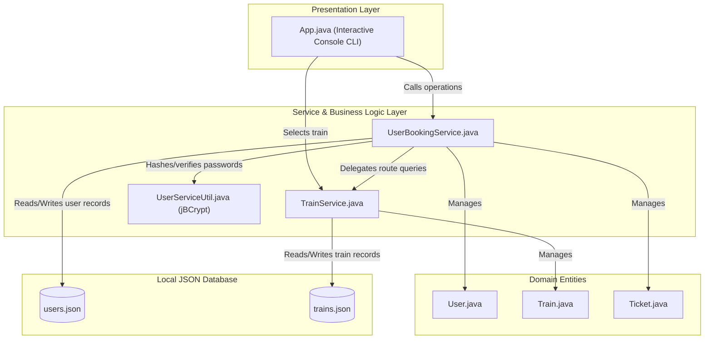
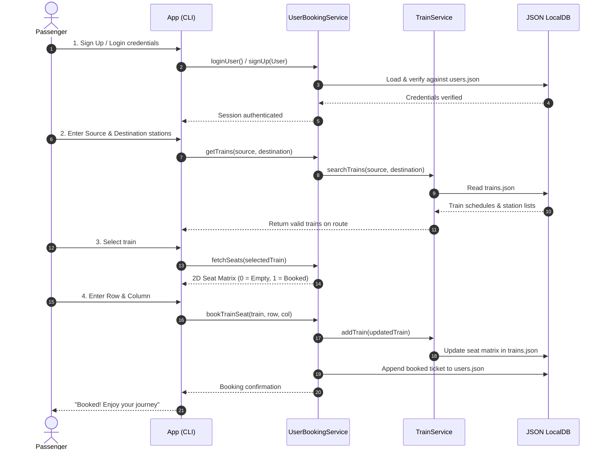

# 🚆 IRCTC Train Ticket Booking System

A lightweight, modular, and secure console-based Railway Ticket Reservation System built in **Java** and powered by **Gradle**. This application simulates core IRCTC functionality including user registration with cryptographic password hashing, train schedule and route search, interactive 2D seat matrix allocation, booking lifecycle management, and file-based JSON persistence.

---

## 📑 Table of Contents

- [Overview](#-overview)
- [System Architecture](#-system-architecture)
- [Key Features](#-key-features)
- [Technology Stack](#-technology-stack)
- [Project Structure](#-project-structure)
- [Data Models & Schema](#-data-models--schema)
- [Prerequisites](#-prerequisites)
- [Installation & Running](#-installation--running)
- [CLI Application Walkthrough](#-cli-application-walkthrough)
- [Testing & Quality Assurance](#-testing--quality-assurance)
- [Roadmap & Enhancements](#-roadmap--enhancements)

---

## 📌 Overview

The **IRCTC Train Ticket Booking System** provides an end-to-end simulation of a railway booking backend and terminal client:
- **Authentication**: Prevents plaintext credential storage using salted **jBCrypt** hashing.
- **Route Validation**: Validates station ordering along multi-stop routes to prevent booking invalid travel legs.
- **Seat Grid Visualization**: Dynamically displays a 2D carriage matrix showing real-time seat availability (`0` for available, `1` for reserved).
- **JSON Persistence**: Persists user credentials, booking history, and train configurations into local database stores using **Jackson Databind**.

---

## 🏗️ System Architecture

The application adopts a **Clean Layered Architecture**, separating the presentation layer from business logic, domain models, and storage mechanisms.

### High-Level Architecture



---

### End-to-End Booking Sequence Flow



---

## ✨ Key Features

| Feature | Description |
| :--- | :--- |
| **User Sign Up & Login** | Secure registration and login flow. Passwords are never stored in plaintext; salted hashes are generated via `BCrypt.gensalt()`. |
| **Train Search & Route Validation** | Searches trains travelling between user-specified stations, verifying that the source station appears before the destination station in the route schedule. |
| **2D Carriage Seat Matrix** | Real-time seat allocation using a 2D integer grid (`List<List<Integer>>`). Ensures no double-booking occurs on reserved seats. |
| **Ticket Cancellation** | Cancel active bookings by unique Ticket ID and automatically update passenger records. |
| **View Bookings** | Passengers can retrieve and inspect all historical and active bookings along with departure/arrival metadata. |
| **JSON Database Persistence** | Automatically syncs state changes back to filesystem-backed JSON documents using Jackson object mapper. |

---

## 🛠️ Technology Stack

- **Language:** Java (JDK 8 up to Java 24 supported)
- **Build Tool:** Gradle 8.14 (with Gradle Wrapper)
- **JSON Processing:** Jackson Databind `2.12.6`
- **Security & Cryptography:** jBCrypt `0.4`
- **Boilerplate & Utilities:** Project Lombok `1.18.22`, Google Guava
- **Testing:** JUnit `4.13.2`

---

## 📂 Project Structure

```text
ticketBooking/
├── app/
│   ├── build.gradle                       # App module build definition and dependencies
│   └── src/
│       ├── main/
│       │   └── java/ticket/booking/
│       │       ├── App.java               # Main entry point & interactive CLI menu
│       │       ├── entities/              # Domain models (POJOs)
│       │       │   ├── Ticket.java        # Ticket model with metadata & train reference
│       │       │   ├── Train.java         # Train model with seat matrix & route stops
│       │       │   └── User.java          # User model with hashed credentials & tickets
│       │       ├── localDB/               # Local JSON persistence storage
│       │       │   ├── trains.json        # Stored trains, seat states, & station times
│       │       │   └── users.json         # Stored users and booked tickets
│       │       ├── service/               # Core business services
│       │       │   ├── TrainService.java  # Route search & train persistence
│       │       │   └── UserBookingService.java # Authentication, booking & seat reservations
│       │       └── util/
│       │           └── UserServiceUtil.java # BCrypt password hashing & matching
│       └── test/
│           └── java/ticket/booking/
│               └── AppTest.java           # Unit test suite
├── gradle/
│   ├── libs.versions.toml                 # Gradle Version Catalog
│   └── wrapper/
│       ├── gradle-wrapper.jar
│       └── gradle-wrapper.properties      # Gradle 8.14 distribution configuration
├── .gitignore                             # Ignored build caches, IDE files, and class binaries
├── gradlew                                # Linux/macOS Gradle wrapper script
├── gradlew.bat                            # Windows Gradle wrapper script
├── settings.gradle                        # Project settings & module inclusions
└── README.md                              # Project documentation
```

---

## 🗄️ Data Models & Schema

### 1. `User` Model
```json
{
  "name": "Jane Doe",
  "password": "password123",
  "hashed_password": "$2a$10$...",
  "user_id": "fe46da4d-c8d1-4229-97e6-600dce6941e8",
  "tickets_booked": []
}
```

### 2. `Train` Model
```json
{
  "train_id": "bacs",
  "train_no": "12345",
  "seats": [
    [0, 0, 0, 0, 0, 0],
    [0, 0, 0, 0, 0, 0],
    [0, 0, 0, 0, 0, 0],
    [0, 0, 0, 0, 0, 0]
  ],
  "station_times": {
    "bangalore": "13:50:00",
    "jaipur": "18:30:00",
    "delhi": "22:15:00"
  },
  "stations": [
    "bangalore",
    "jaipur",
    "delhi"
  ]
}
```

---

## ⚙️ Prerequisites

- **Java Development Kit (JDK)**: Version 8 or higher (compatible through Java 24).
- **Git**: For version control.

> [!NOTE]
> Gradle does not need to be installed on your machine. The included `./gradlew` (Gradle Wrapper) handles downloading and executing the appropriate Gradle runtime automatically.

---

## 🚀 Installation & Running

### 1. Clone the Repository
```bash
git clone https://github.com/ashutoshukale/ticketBooking.git
cd ticketBooking
```

### 2. Build the Application
```bash
# On Linux / macOS:
./gradlew clean build

# On Windows (PowerShell):
.\gradlew.bat clean build
```

### 3. Run the Application
```bash
# On Linux / macOS:
./gradlew run --console=plain

# On Windows (PowerShell):
.\gradlew.bat run --console=plain
```

---

## 💻 CLI Application Walkthrough

When you launch the application, you will be presented with the interactive menu:

```text
Running Train Booking System
Choose option
1. Sign up
2. Login
3. Fetch Bookings
4. Search Trains
5. Book a Seat
6. Cancel my Booking
7. Exit the App
```

### Example Usage Workflow:

1. **Sign Up**: Select option `1`, enter your desired username and password. The application hashes the password and registers your user ID into `users.json`.
2. **Login**: Select option `2` to log in with your credentials.
3. **Search Trains**: Select option `4`, enter source station (e.g., `bangalore`) and destination station (e.g., `delhi`). Available train routes and timing schedules are returned.
4. **Inspect & Book Seat**: Select option `5`. The 2D seat matrix is rendered:
   ```text
   0 0 0 0 0 0
   0 0 1 0 0 0
   0 0 0 0 0 0
   0 0 0 0 0 0
   ```
   Enter the desired row index (e.g., `0`) and column index (e.g., `1`). Once confirmed, seat `[0][1]` transitions from `0` to `1` (booked) and is persisted to disk.
5. **Fetch Bookings**: Select option `3` to display your booked tickets and itinerary details.
6. **Cancel Booking**: Select option `6` and input your Ticket ID to cancel the reservation.

---

## 🧪 Testing & Quality Assurance

Unit tests are written using **JUnit 4** and located under `app/src/test/java/ticket/booking/`.

To run the test suite:
```bash
# Linux / macOS
./gradlew test

# Windows (PowerShell)
.\gradlew.bat test
```

Test reports are automatically generated in HTML format at:
```text
app/build/reports/tests/test/index.html
```

---

## 🔮 Roadmap & Enhancements

- [ ] **Database Migration**: Transition from flat JSON files to a relational database (PostgreSQL / MySQL) with Spring Data JPA or Hibernate.
- [ ] **RESTful API**: Expose business services as RESTful endpoints using **Spring Boot**.
- [ ] **Concurrent Booking Support**: Add thread-safe synchronization/locks or optimistic locking on seat bookings to handle concurrent passenger requests.
- [ ] **Multi-Seat Selection**: Enable booking multiple seats in a single reservation transaction.
- [ ] **Payment Gateway Integration**: Mock payment processing and receipt generation.

---

## 📄 License

This project is open-source and available under the [MIT License](LICENSE).
